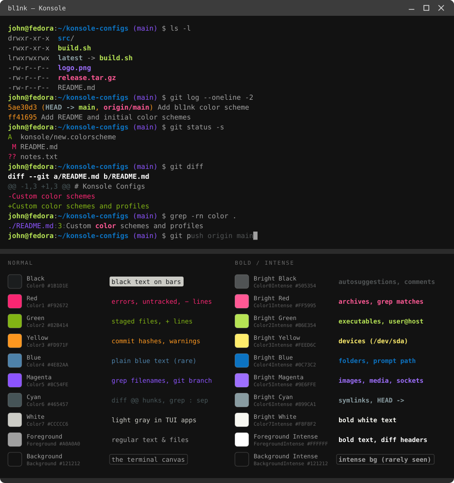
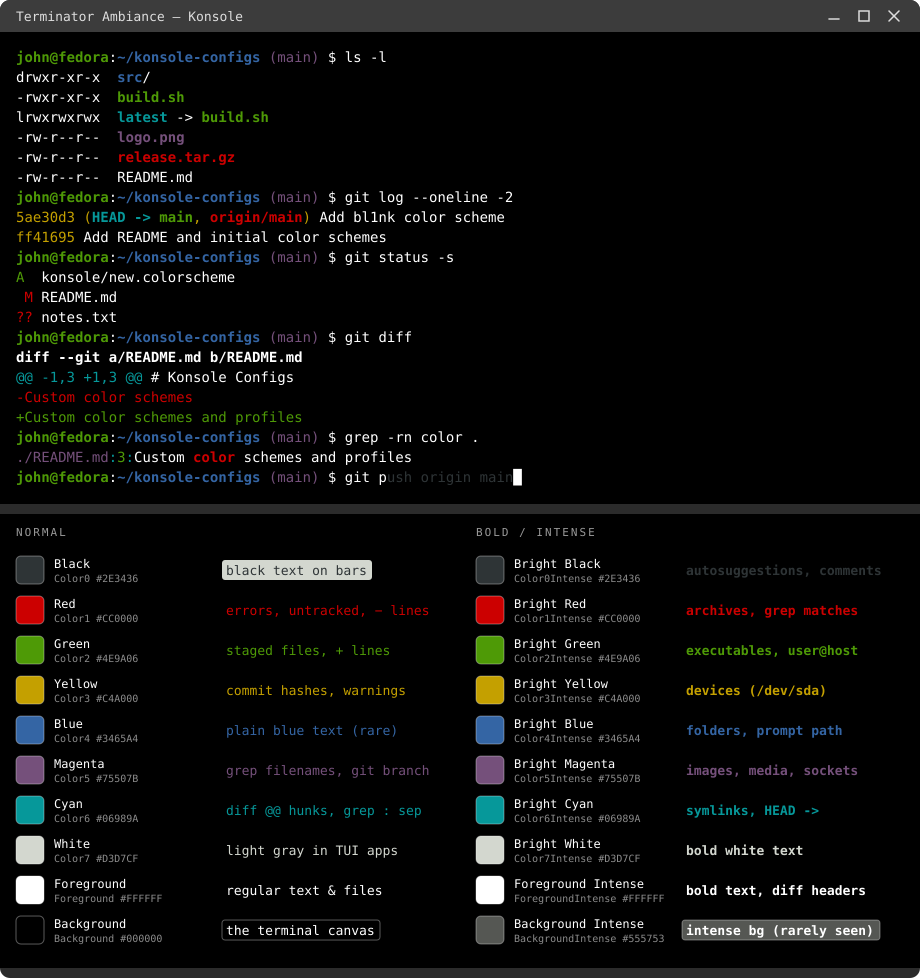

# Konsole Configs

Custom color schemes and profiles for Konsole

## How to apply

1. Install [Konsole](https://apps.kde.org/konsole/)
2. Copy Konsole folder to `cp -r konsole ~/.local/share/konsole` or the desired `*.colorscheme` file

<!-- palettes:start -->

<!-- Generated by scripts/render_palettes.py — do not edit by hand. -->

## Palettes

### bl1nk

`konsole/148925-bl1nk.colorscheme`

Color table

| | Slot | Hex | Where you'll see it |
|---|---|---|---|
|  | Black (`Color0`) | `#1B1D1E` | Black text drawn on top of colored highlights (status bars, fzf/tmux selections) |
|  | Bright Black (`Color0Intense`) | `#505354` | Dimmed gray: zsh autosuggestions, comments, hints |
|  | Red (`Color1`) | `#F92672` | Errors, `git status` untracked/modified files, `git diff` removed lines |
|  | Bright Red (`Color1Intense`) | `#FF5995` | **Bold red**: archives in `ls` (`.tar.gz`, `.zip`), `grep` matches, `origin/…` in `git log` |
|  | Green (`Color2`) | `#82B414` | `git status` staged files, `git diff` added lines, `grep` line numbers |
|  | Bright Green (`Color2Intense`) | `#B6E354` | **Bold green**: executables in `ls`, local branch in `git log`, `user@host` in prompts |
|  | Yellow (`Color3`) | `#FD971F` | Commit hashes in `git log`, warnings |
|  | Bright Yellow (`Color3Intense`) | `#FEED6C` | **Bold yellow**: block/char devices in `ls /dev` |
|  | Blue (`Color4`) | `#4E82AA` | Non-bold blue — rare in the shell, shows up in syntax highlighting / TUI apps |
|  | Bright Blue (`Color4Intense`) | `#0C73C2` | **Bold blue**: 📁 folders in `ls`, the current path in most prompts |
|  | Magenta (`Color5`) | `#8C54FE` | Filenames in `grep -r` output, git branch in many prompts |
|  | Bright Magenta (`Color5Intense`) | `#9E6FFE` | **Bold magenta**: images/media files and sockets in `ls` |
|  | Cyan (`Color6`) | `#465457` | `@@` hunk headers in `git diff`, `:` separators in `grep` |
|  | Bright Cyan (`Color6Intense`) | `#899CA1` | **Bold cyan**: symlinks in `ls`, `HEAD ->` in `git log` |
|  | White (`Color7`) | `#CCCCC6` | Light gray used by TUI apps that ask for "white" (htop, mc) |
|  | Bright White (`Color7Intense`) | `#F8F8F2` | Bright white for bold white text |
|  | Foreground (`Foreground`) | `#A0A0A0` | Everything uncolored: command output, regular files, what you type |
|  | Foreground Intense (`ForegroundIntense`) | `#FFFFFF` | **Bold** uncolored text: `diff --git` headers, man page headings |
|  | Background (`Background`) | `#121212` | The terminal canvas |
|  | Background Intense (`BackgroundIntense`) | `#121212` | Default background with the intense attribute — rarely visible |

### Terminator Ambiance

`konsole/Terminator.colorscheme`

Color table

| | Slot | Hex | Where you'll see it |
|---|---|---|---|
|  | Black (`Color0`) | `#2E3436` | Black text drawn on top of colored highlights (status bars, fzf/tmux selections) |
|  | Bright Black (`Color0Intense`) | `#2E3436` | Dimmed gray: zsh autosuggestions, comments, hints |
|  | Red (`Color1`) | `#CC0000` | Errors, `git status` untracked/modified files, `git diff` removed lines |
|  | Bright Red (`Color1Intense`) | `#CC0000` | **Bold red**: archives in `ls` (`.tar.gz`, `.zip`), `grep` matches, `origin/…` in `git log` |
|  | Green (`Color2`) | `#4E9A06` | `git status` staged files, `git diff` added lines, `grep` line numbers |
|  | Bright Green (`Color2Intense`) | `#4E9A06` | **Bold green**: executables in `ls`, local branch in `git log`, `user@host` in prompts |
|  | Yellow (`Color3`) | `#C4A000` | Commit hashes in `git log`, warnings |
|  | Bright Yellow (`Color3Intense`) | `#C4A000` | **Bold yellow**: block/char devices in `ls /dev` |
|  | Blue (`Color4`) | `#3465A4` | Non-bold blue — rare in the shell, shows up in syntax highlighting / TUI apps |
|  | Bright Blue (`Color4Intense`) | `#3465A4` | **Bold blue**: 📁 folders in `ls`, the current path in most prompts |
|  | Magenta (`Color5`) | `#75507B` | Filenames in `grep -r` output, git branch in many prompts |
|  | Bright Magenta (`Color5Intense`) | `#75507B` | **Bold magenta**: images/media files and sockets in `ls` |
|  | Cyan (`Color6`) | `#06989A` | `@@` hunk headers in `git diff`, `:` separators in `grep` |
|  | Bright Cyan (`Color6Intense`) | `#06989A` | **Bold cyan**: symlinks in `ls`, `HEAD ->` in `git log` |
|  | White (`Color7`) | `#D3D7CF` | Light gray used by TUI apps that ask for "white" (htop, mc) |
|  | Bright White (`Color7Intense`) | `#D3D7CF` | Bright white for bold white text |
|  | Foreground (`Foreground`) | `#FFFFFF` | Everything uncolored: command output, regular files, what you type |
|  | Foreground Intense (`ForegroundIntense`) | `#FFFFFF` | **Bold** uncolored text: `diff --git` headers, man page headings |
|  | Background (`Background`) | `#000000` | The terminal canvas |
|  | Background Intense (`BackgroundIntense`) | `#555753` | Default background with the intense attribute — rarely visible |

Regenerate after editing a scheme: `python3 scripts/render_palettes.py`

<!-- palettes:end -->
